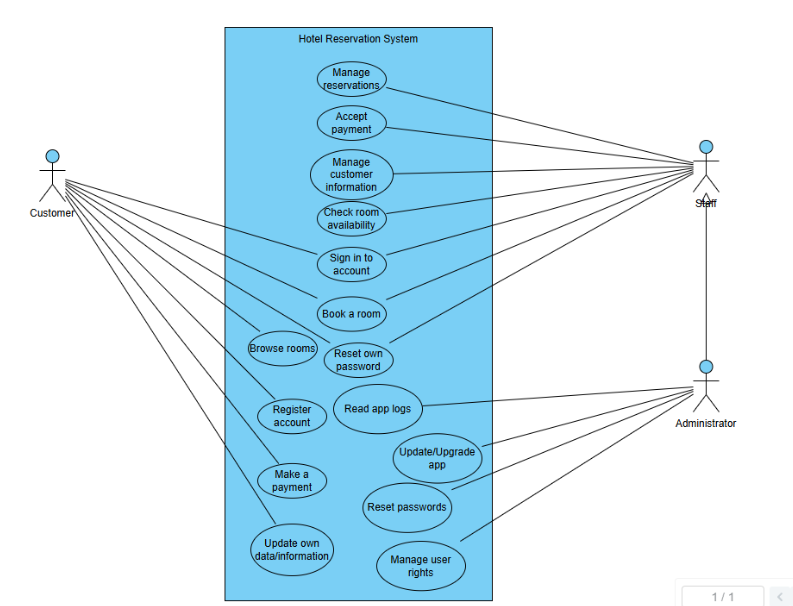
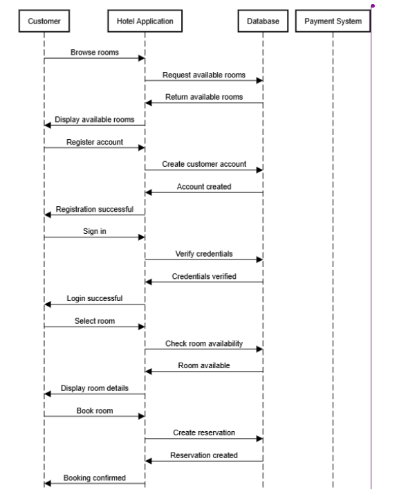
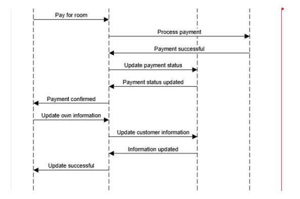

# Hotel Reservation Application – Requirements Specification

 **Teemu Perkiö** — e2402257\
 **Tuomas Yli-Korpela** — e2402259\
 **Arttu Tikkamäki** — e2402594

---

 ## 1\. Identify the Stakeholders and User Needs

 ### Hotel Staff

 **Manage reservations:**

- Add reservations
- Edit reservations
- Remove reservations
- Accept payments
- Manage customer account information

 ### Administrator / IT Support

- Read application logs
- Update and upgrade the application
- Reset passwords
- Manage user rights

 ### Customer

 - Browse rooms
- Register an account
- Sign in to an account
- Book a room
- Pay for the room
- Update their own data/information

---

 # 2\. Define the Overall Application Requirements

 ## 2.1 Functional Requirements

 ### User Interface (UI)

 The application shall provide:

- Graphical user interface
- Navigation menu
- Authorization and authentication panel
- Room browsing
- Payment information
- Admin panel

 ### Data Management

 The application shall support CRUD operations:

 - **Create**
- **Read**
- **Update**
- **Delete**

 ### User Authentication and Authorization

 The application shall support:

 - User login and registration
- Different user roles:
  - Customer
  - Hotel staff
  - Administrator

 ### Business Logic

 - Room reservation management

 ### Search Functionality

 The system shall provide the ability to search for:

 - Rooms
- Customers
- Other relevant information

 ### Payment Integration

 The application shall support integration with payment methods such as:

 - PayPal
- MobilePay
- Visa
- Other supported payment services

(Payment functionality will be mocked in some way when creating the first version.)

 ### Notifications

 The system shall provide notifications for:

 - Accepted room reservations
- Cancelled reservations

---

 ## 2.2 Performance Requirements

 ### Response Time

 - Pages should load quickly.

 ### Scalability

 - The application must handle increasing numbers of users and requests as it grows.
- The system should support horizontal or vertical scaling to accommodate high traffic.

 ### Concurrency

 - The application must support multiple users accessing the system simultaneously without significant performance degradation.

---

 ## 2.3 Usability Requirements

 ### Localization / Internationalization

 The application shall support multiple languages.

 The system must properly handle:

- Currency
- Date formats
- Time formats

 Formats should be based on the user's locale.

 ### User Documentation

 The application shall provide:

- Guides
- FAQs
- Help articles for end-users

 Documentation should explain how to use the application.

---

 ## 2.4 Security

 ### Data Encryption

 - Sensitive data must be encrypted both in transit and at rest.

 ### Input Validation

 Input validation must be implemented to prevent injection attacks, such as:

- SQL injection

 ### Session Management

- User sessions should have timeouts.
- Token-based authentication should be used.
- The system should prevent session hijacking.

 ### Data Privacy

 - Personal data must be handled securely and according to applicable data privacy regulations.

 ### Role-Based Security

 - Access control mechanisms must ensure that users can only access features and data they are authorized to use.

 ### Logging and Monitoring

 Centralized logging and monitoring should be implemented for detecting:

- System issues
- Performance bottlenecks
- Security breaches

 ### Audit Trails

 The system must be able to track changes made to:

- Data
- Configurations

 Audit trails should support compliance requirements.

---

 ## 2.5 Availability

 ### Uptime Requirements

- The application should have **99% uptime**.
- Backup and failover mechanisms should be included.

 ### Disaster Recovery

 Procedures must be available for:

- Data backup
- Data restoration
- System recovery in case of hardware or software failures

---

 ## 2.6 Reliability

 ### Error Handling

- Errors should be handled gracefully.
- Users should receive meaningful error messages.
- Developers should have access to detailed error logs.

 ### Consistency

 - The application should behave consistently across different modules and user actions.

---

 ## 2.7 Maintainability

 ### Modular Code Design

 The application should use modular and well-documented code.

 Modular design should simplify:

- Future enhancements
- Debugging
- Maintenance

 ### Automated Testing

 The application should include:

- Unit tests
- Integration tests
- End-to-end tests

 Automated testing should ensure that changes do not introduce new bugs.

 ### Technical Documentation

 Documentation should be maintained for:

- System architecture
- APIs
- Deployment procedures

---

 ## 2.8 Constraints

 The application must comply with applicable data privacy regulations, such as:

 - GDPR
- HIPAA, where applicable

 Additionally:

 - All payment transactions and payment information must be routed through a trusted third-party payment provider.
- Payment information must not be stored in the application's own database.

---

 ## 2.9 Architecture and Deployment Model

 The application shall be split into separate client and backend components:

 - **MAUI Client Application** (presentation and client-side interaction)
- **ASP.NET Core Web API** (business/application services and data access boundary)
- **SQLite database file persisted through Docker named volume**

 The API and database are intended to run in Docker-based environments, especially for local development using Docker Compose.

 ### MVVM in the Split Architecture

 MVVM remains the client architecture pattern:

 - **Views** and **ViewModels** stay in the MAUI project.
- ViewModels call service abstractions that use HTTP clients.
- ViewModels must not directly access persistence or infrastructure implementations.
- Backend-side business rules, validation, and persistence are implemented in the API layer.

 ### Shared Contracts

 The solution should include a shared class library for API request/response contracts (DTOs) used by both MAUI and API projects.

 ### Initial Delivery Scope

 The first implementation milestone focuses on a backend skeleton:

 - Basic API project structure
- Containerized API runtime
- SQLite persistence wiring with named volume
- No authentication in the initial backend skeleton milestone

---

 # 3\. Partition the Application into Logical Subsystems

 ## 3.1 User Management

 ### Purpose and Responsibilities

 - Customer registration and login
- Profile management
- Password recovery
- Management of user roles:
  - Customer
  - Hotel staff
  - Administrator

 ### Inputs

 - Initial registration information
- User credentials
- New information for updating a profile

 ### Outputs

 - User profile
- User permissions

 ### Functional Requirements

 - Users should be able to register using their email address.
- Users should be able to log in and log out.
- Users should be able to update their personal information.

 ### Non-Functional Requirements

 - Passwords must be encrypted.
- Login should take less than **2 seconds**.
- The system must comply with GDPR.

---

 ## 3.2 Hotel & Room Management

 ### Purpose and Responsibilities

 - Maintaining hotel information
- Managing room information
- Maintaining information about room availability

 ### Inputs

 - Hotel information
- Room information
- Updates to room availability

 ### Outputs

 - List of available rooms
- Room information served to the user

 ### Functional Requirements

 - The system must store information about hotels and rooms.
- Staff must be able to add, edit, and delete rooms.
- Room availability must be updated in real time.

 ### Non-Functional Requirements

 - The data must be available with **99.9% uptime**.
- Searches must return results in less than **3 seconds**.

---

 ## 3.3 Booking Management

 ### Purpose and Responsibilities

 - Creating, modifying, and cancelling room reservations
- Managing reservation statuses
- Preventing overlapping reservations

 ### Inputs

 - Reservation request
- Check-in and check-out dates
- Customer information

 ### Outputs

 - Booking confirmation
- Booking number
- Booking status

 ### Functional Requirements

- Customers must be able to cancel reservations according to the applicable cancellation rules.
- The system must prevent duplicate bookings.

 ### Non-Functional Requirements

 - Reservation processing must take less than **5 seconds**.
- Data integrity must be maintained during all reservation transactions.

---

 ## 3.4 Payment Processing

 ### Purpose and Responsibilities

 - Integrate the booking system with an external payment service.
- Transmit payment requests to the payment service provider.
- Receive notifications of payment success or failure.
- Update the booking status based on the payment transaction.

 ### Inputs

 - Booking details
- Amount to be paid
- Customer's selected payment method

 ### Outputs

 **Payment status:**

- Successful
- Failed
- Pending

 Additional outputs:

 - Payment confirmation
- Updated booking information

 ### Functional Requirements

 - The system must be able to send a payment request to the selected payment service provider.
- The system must receive the payment status returned by the payment service provider.
- The booking status must be updated automatically after a successful payment.
- The system must handle failed payments and notify the user.

 ### Non-Functional Requirements

 - Payment transactions must take place over a secure HTTPS connection.
- The payment service integration must be reliable and recover from errors.
- The system must not store customers' credit card information in its own database.
- The payment service response time must allow the booking to be confirmed within a few seconds.

---

 ## 3.5 Search & Recommendation

 ### Purpose and Responsibilities

- Searching for hotels and rooms
- Filtering and sorting search results
- Providing recommendations

 ### Inputs

 **Search criteria:**

- Destination
- Dates
- Number of guests
- Filters

 ### Outputs

- Search results
- Recommended rooms

 ### Functional Requirements

 Users must be able to search for available rooms.

 Results must be filterable by:

 - Price
- Location
- Star rating

 ### Non-Functional Requirements

- Search results must load in less than **2 seconds**.
- The system must support a large number of simultaneous users.

---

 ## 3.6 Notification Service

 ### Purpose and Responsibilities

 - Sending booking confirmations
- Sending reminders
- Sending cancellation and modification notifications

 ### Inputs

 - Booking events
- Customer contact details

 ### Outputs

 - Emails
- Push notifications

 ### Functional Requirements

 - Booking confirmations must be sent automatically.
- Customers must be notified of cancellations.

 ### Non-Functional Requirements

 - Notifications must be sent within **1 minute** of the event.
- Notification delivery reliability must be greater than **99%**.

---

 # 4\. Using Quality Function Deployment (QFD)

 | Customer Need | Importance | Technical Requirement |
| --- | --- | --- |
| Easy room browsing and searching | 5 | Fast search and simple user interface |
| Reliable room reservations | 5 | Availability checking and prevention of double-booking |
| Secure payments | 5 | Third-party payment integration and encryption |
| Protection of personal data | 5 | Authentication, authorization, and data encryption |
| Easy registration and login | 4 | Secure account management |
| Staff can manage reservations | 4 | Reservation CRUD functionality |
| Application is reliable and available | 5 | 99% uptime, backups, and error handling |
| Reliable notifications | 3 | Automatic reservation and cancellation notifications |
| Admin can manage users | 3 | Role-based access control |

---

 # Summary of Logical Subsystems

 The application is divided into the following **six main subsystems**:

1. **User Management**
2. **Hotel & Room Management**
3. **Booking Management**
4. **Payment Processing**
5. **Search & Recommendation**
6. **Notification Service**

 These subsystems together provide the core functionality required for customers, hotel staff, and administrators while addressing the application's functional and non-functional requirements.

---

 # 5\. Database Schema Overview

 A simple initial database schema has been defined in:

 - `Documentation/DatabaseSchema.md`

 The schema is intentionally minimal to support backend API development and unit testing before full Docker and database deployment tasks are completed.

 ## Core Tables

 - `Users`
- `Hotels`
- `Rooms`
- `Reservations`
- `Payments`
- `Notifications` (optional in first backend skeleton)

 ## Core Relationships

 - One hotel has many rooms.
- One user has many reservations.
- One room has many reservations.
- One reservation has many payments.
- One user has many notifications.

 ## Key Constraints

 - User email must be unique.
- Room number must be unique per hotel.
- Check-in date must be before check-out date.
- Overlapping active reservations for the same room are not allowed.
- Guest count must be positive and within room capacity.

 This structure supports the split architecture (MAUI client + ASP.NET Core API) and allows persistence implementation to be added incrementally.

## Diagrams

*Figure 1. Hotel Reservation System Use Case Diagram*

*Figure 2. Browsing and Reserving a Room Sequence Diagram*

